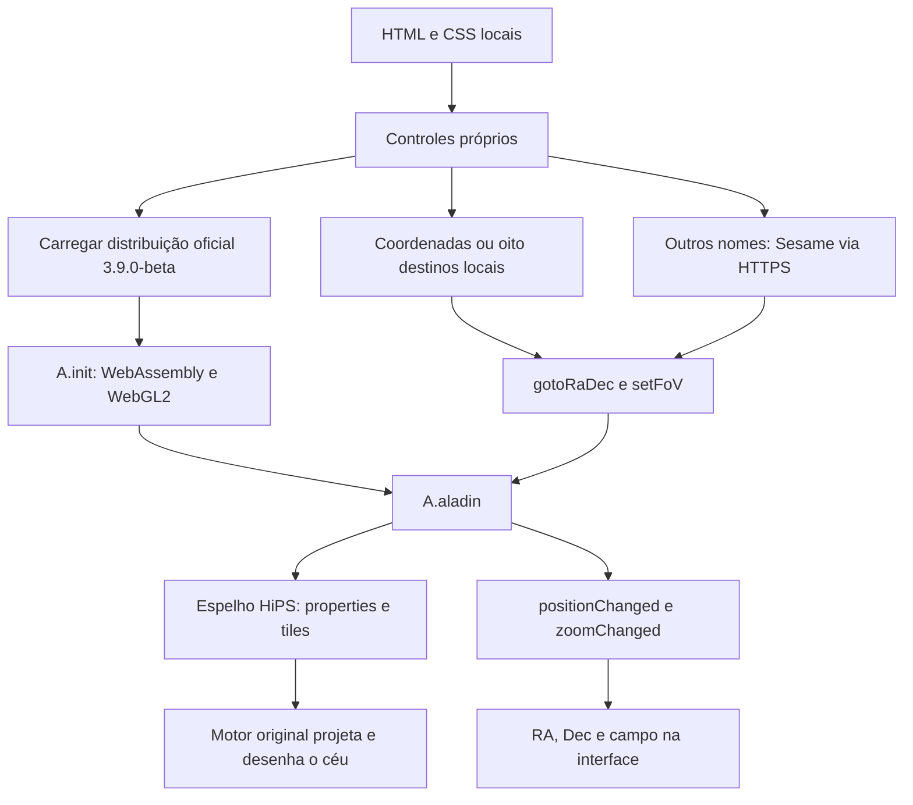

# Arquitetura e investigação

Consulta e importação: 14/11/2026. Esta análise separa fatos encontrados nos fontes oficiais de decisões da aplicação própria. Não houve captura de tráfego de um navegador funcional nesta sessão.

## Identidade da ferramenta

O [README do projeto CDS](https://github.com/cds-astro/aladin-lite) aponta para a URL solicitada, e a documentação do Aladin Lite aponta para esse repositório. O código foi obtido de `cds-astro/aladin-lite`, commit `60c5cf414d6d56a10b406761e62e8c2ce9f2a760`, versão declarada `3.9.0-beta`. Arquivos originais e manifesto de hashes estão em `../upstream/`.

A página pública hoje é descrita pelo próprio CDS como uma versão de contingência. Ela apresenta espelhos de levantamentos, resolução de nomes, SIMBAD, inclusão de catálogos VizieR e arquivos CSV/VOTable. A extração textual da página confirma esses controles, mas não mostra a implementação completa do HTML/JS dessa interface. **Não há prova de equivalência byte a byte entre o commit importado e todos os scripts atualmente publicados na página.** A identidade confirmada é a do projeto e de seu motor público.

## Componentes confirmados pela leitura dos fontes

| Camada | Evidência local original | Responsabilidade |
| --- | --- | --- |
| API JavaScript | `upstream/aladin-lite/src/js/A.js` | Entrada pública, inicialização, fábricas de catálogos e objetos |
| Instância do atlas | `src/js/Aladin.js` no upstream | Métodos para câmera, camadas, projeção, coordenadas e eventos |
| Interação | `src/js/View.js` no upstream | Eventos de mouse/toque, arraste, zoom e atualização da vista |
| HiPS | `src/js/HiPS.js` no upstream | Leitura de propriedades, formatos e resolução dos levantamentos |
| Núcleo Rust | `src/core/src/lib.rs`, `app.rs`, `camera/` | Estado/renderização expostos ao JavaScript via WebAssembly |
| GPU | `src/core/al-core/`, `src/glsl/`, `src/core/src/shaders.rs` | Abstrações gráficas e shaders usados pelo motor WebGL2 |
| Downloads | `src/core/src/tile_fetcher.rs`, `downloader/` | Fila de solicitações e tiles carregados |
| Busca original | `src/js/Sesame.js` | Resolução de nome por serviço HTTP; interpretação da linha `%J` |
| Compilação | `package.json`, `vite.config.ts` | wasm-pack para Rust, Vite para módulos ES e UMD |

Os caminhos abreviados nessa tabela ficam dentro de `upstream/aladin-lite/`. O `A.init` verifica WebGL2 e aguarda a inicialização do módulo WASM. O núcleo se apoia em bibliotecas científicas Rust como cdshealpix, mapproj, fitsrs e moc, conforme README e manifests Cargo.

## Como as imagens formam o mapa

HiPS organiza levantamentos sobre a tesselação HEALPix da esfera, em níveis progressivos de resolução. O número de células em uma ordem `k` é `12 × 4^k`; ordem HEALPix não é a mesma coisa que a largura em pixels de cada tile. O arquivo `properties` informa, entre outros campos, ordem máxima, tamanho dos tiles, sistema de coordenadas e formatos disponíveis. No esquema HiPS, URLs de tiles seguem a estrutura `NorderK/DirD/NpixP.ext`; a implementação dessas requisições pertence ao motor original.

A câmera, o campo de visão e a projeção determinam quais regiões precisam aparecer. O motor obtém tiles adequados à região e ao nível de detalhe, usa recursos de GPU e faz a projeção da esfera para a tela. O zoom muda o campo angular e a demanda de detalhe; não é simplesmente ampliar uma fotografia única. Mover a vista provoca novas requisições conforme necessário.

**Inferência de projeto:** essa estrutura permite explorar levantamentos muito maiores que a memória do navegador sem carregar todos os pixels. Não fizemos medições de tempo, memória, taxa de quadros ou tráfego para quantificar o benefício nesta entrega.

## Coordenadas e navegação

A API oferece `gotoRaDec`, `getRaDec`, `getFov`, `setFoV`, `pix2world` e `world2pix`. Nossa interface mantém os valores em ICRS e graus decimais, valida RA em `[0, 360)` e declinação em `[-90, 90]`, e envia a posição para o motor. O rótulo ICRS/J2000 acompanha o uso comum do atlas; ICRS e FK5/J2000 não são referenciais rigorosamente idênticos. A implementação original comenta que a diferença não é perceptível para os propósitos visuais do visualizador.

O arraste e a roda são tratados pela própria biblioteca. Eventos `positionChanged` e `zoomChanged` atualizam nossos indicadores, sem acessar detalhes privados do WASM. O campo exibido é o primeiro valor de `getFov()` (largura angular); a altura pode ser diferente.

## Catálogos, protocolos e serviços

Imagens e catálogos são camadas distintas: as primeiras contêm pixels; os segundos contêm fontes com coordenadas e atributos. A API original permite catálogos locais, consultas a SIMBAD/VizieR/NED, catálogos HiPS progressivos, sobreposições e coberturas MOC. O código também contém integração SAMP e leitura de imagens FITS. A existência desses recursos foi verificada no código/documentação; não implica que todos os serviços estejam operacionais hoje.

O catálogo didático local de oito referências usa `A.catalog`, `A.source` e `addCatalog`. Um catálogo científico separado agora permite fontes por região, seleção e medições no infravermelho, com provedor HTTP configurável ou demonstração explicitamente ativada. O contrato ainda é provisório: veja [backend-infravermelho.md](backend-infravermelho.md). A resolução de outros nomes usa HTTP(S) do Sesame com resposta textual e posição `%J`; não confundir essa busca com baixar um catálogo inteiro. As imagens usam HiPS sobre HTTPS nos espelhos ESA e China-VO. Não há implementação de backend científico neste repositório.

## Fluxo da demonstração própria

1. O servidor Node entrega os arquivos locais; não compila o motor.
2. O app restaura o estado válido do fragmento da URL, se houver.
3. Tenta o bundle local opcional, a URL oficial de contingência e a URL versionada oficial. Aguarda `A.init` com limite de tempo.
4. Cria a vista com URL direta do levantamento, evitando depender de descoberta do registro para selecionar a camada inicial.
5. Cria o catálogo didático oculto, conecta eventos e habilita os controles.
6. Busca local não precisa de Sesame. Busca remota tem cancelamento e limite de 12 segundos; uma resposta antiga não substitui uma navegação posterior.
7. A verificação de metadados do espelho informa falha de conexão, sem fingir validar a renderização de tiles.

## Decisão de implementação

Integramos o motor oficial sem modificá-lo. Reimplementar projeções e streaming HiPS ampliaria muito o escopo e exigiria validação científica. O estudo entrega fontes legíveis para entender essas partes e um exemplo de como construir nossa própria interface com a API existente. Essa é uma escolha de implementação, não uma descoberta de componentes proprietários.

Para reproduzir exatamente a página atual, ainda seria necessário obter seu HTML/JS específico e validá-lo no navegador. Esta entrega não afirma ter feito essa reprodução exata.
