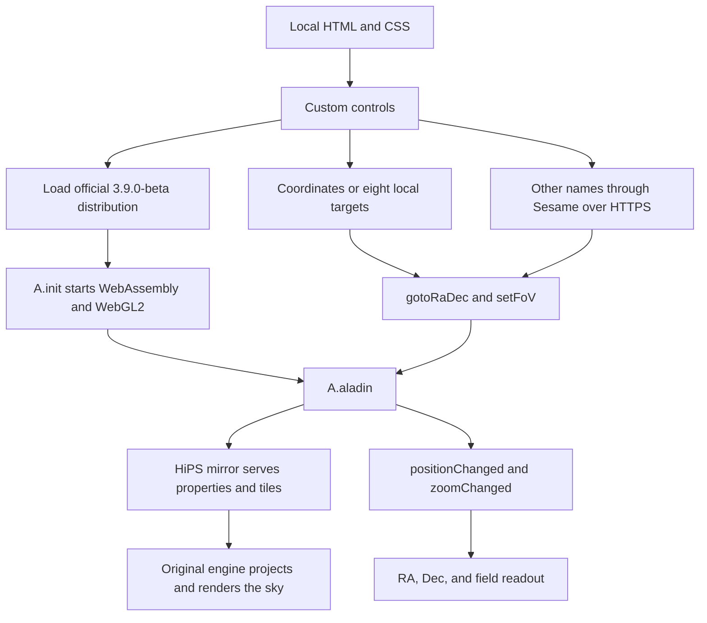

# Architecture and source investigation

Research and import were performed on November 14, 2026. This document records an investigation of the official source and the implementation decisions for the standalone demonstration. The session did not capture live browser traffic.

## Tool identity

The [CDS project README](https://github.com/cds-astro/aladin-lite) points to the requested page, and the Aladin Lite documentation points to that repository. The source came from `cds-astro/aladin-lite` at commit `60c5cf414d6d56a10b406761e62e8c2ce9f2a760`, declared version `3.9.0-beta`. The original files and hash manifest are in [upstream](../upstream/).

CDS described the public page as a contingency previewer. Its controls include survey mirrors, name resolution, SIMBAD, VizieR catalogs, and CSV/VOTable files. Text extracted from the page confirmed those controls. The investigation established the identity of the project and engine. The page's full HTML/JavaScript implementation and byte-for-byte equivalence between its published scripts and the imported commit remained unverified.

## Components confirmed in the source

| Layer | Local upstream evidence | Responsibility |
| --- | --- | --- |
| JavaScript API | `upstream/aladin-lite/src/js/A.js` | Public entry point, initialization, catalog and source factories |
| Atlas instance | `src/js/Aladin.js` | Camera, layers, projection, coordinates, and events |
| Interaction | `src/js/View.js` | Mouse and touch events, panning, zoom, and view updates |
| HiPS | `src/js/HiPS.js` | Survey properties, formats, and resolution |
| Rust core | `src/core/src/lib.rs`, `app.rs`, `camera/` | State and rendering exposed to JavaScript through WebAssembly |
| GPU | `src/core/al-core/`, `src/glsl/`, `src/core/src/shaders.rs` | Graphics abstractions and shaders for WebGL 2 |
| Downloads | `src/core/src/tile_fetcher.rs`, `downloader/` | Request queue and loaded tiles |
| Native search | `src/js/Sesame.js` | HTTP name resolution and parsing the `%J` line |
| Build | `package.json`, `vite.config.ts` | wasm-pack for Rust and Vite for ES and UMD builds |

Abbreviated paths are relative to `upstream/aladin-lite/`. `A.init` checks WebGL 2 and waits for the WASM module. The upstream README and Cargo manifests list Rust science libraries including cdshealpix, mapproj, fitsrs, and moc.

## How the imagery forms the map

HiPS uses HEALPix tessellation to organize surveys over the sphere at progressively finer resolutions. Order `k` has `12 × 4^k` cells. HEALPix order and tile width in pixels are separate properties. The `properties` file gives the maximum order, tile size, coordinate frame, available formats, and other metadata. The original engine requests tiles through URLs of the form `NorderK/DirD/NpixP.ext`.

The camera, field of view, and projection define the visible region. The engine fetches tiles for the region and level of detail and uses the GPU to project the sphere onto the screen. Zoom changes the angular field of view and requested detail. Panning requests new tiles as needed.

This design lets the browser explore surveys larger than its available memory by loading tiles on demand. The investigation did not measure time, memory, frame rate, or traffic to quantify that benefit.

## Coordinates and navigation

The API provides `gotoRaDec`, `getRaDec`, `getFov`, `setFoV`, `pix2world`, and `world2pix`. The interface uses decimal ICRS degrees, validates RA in `[0, 360)` and declination in `[-90, 90]`, and passes the position to the engine. The ICRS/J2000 label follows common atlas usage. ICRS and FK5/J2000 are distinct frames, and the upstream implementation notes that their difference is imperceptible for the viewer's visual use.

The library handles drag and wheel input. `positionChanged` and `zoomChanged` update the indicators via public events. The field display uses the first `getFov()` value, its angular width. The height may differ.

## Catalogs, protocols, and services

Image layers contain pixels. Catalog layers contain sources with coordinates and attributes. Upstream supports local catalogs, SIMBAD/VizieR/NED queries, progressive HiPS catalogs, overlays, and MOC coverage. Its source also includes SAMP integration and FITS image reading. The source establishes support for these capabilities. Live service availability was outside the investigation.

The eight educational references use `A.catalog`, `A.source`, and `addCatalog`. A separate science catalog supports regional sources, selection, and infrared measurements through a configurable HTTP provider or an explicitly enabled demo. See the [provisional contract](backend-infravermelho.md) for this prototype. Other names resolve through Sesame over HTTP(S), with textual `%J` positions. Images use HiPS over HTTPS on the ESA and China-VO mirrors. This standalone demonstration had no science backend.

## Standalone demonstration flow

1. The Node server serves local files. Engine compilation is separate.
2. The app restores valid state from the URL fragment when present.
3. It tries the optional local bundle, the official contingency URL, and the official versioned URL, then waits for `A.init` with a timeout.
4. It creates the view with a direct survey URL so the initial layer can load independently of registry discovery.
5. It creates the hidden educational catalog, connects events, and enables controls.
6. Local search works independently of Sesame. Remote search supports cancellation and a 12-second timeout. Stale results cannot override subsequent navigation.
7. Image status uses public `A.HiPS` callbacks. Engine startup, layer preparation, and access errors are separate states. Layer success leaves tile rendering unconfirmed. See [state, pinning, and sharing](melhorias-analise.md).

## Implementation decision

The demo integrates the official engine through its public API. Reimplementing projections and HiPS streaming would expand the project substantially and require scientific validation. The imported source and example show how to build a custom interface on the existing API.

Exact reproduction of the public page would require obtaining its specific HTML and JavaScript and validating them in the browser.
